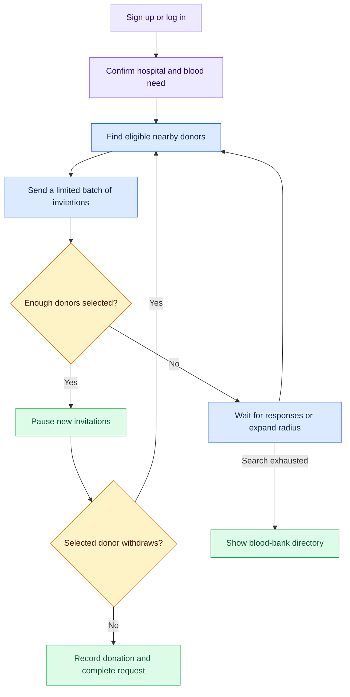
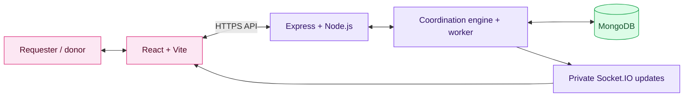

<div align="center">

# 🩸 LifeLink

### Find nearby donors. Follow every response.

A blood donor coordination web app that keeps searching when help is still needed.


**Hospital-centred search · Live responses · Automatic follow-up · English / தமிழ்**

[Two-device guide](MANUAL_TEST.md) · [Deployment](HOSTING.md) · [Validation](VALIDATION.md)

</div>

---

## 💜 What is LifeLink?

LifeLink connects people requesting blood with people willing to donate. **One account can do both.** Requesters enter the hospital, blood group, urgency, quantity and number of donors needed. Donors save their blood group, availability and recent location, then respond to matching invitations.

The main feature is **response-aware coordination**: sending an alert is only the beginning. LifeLink follows responses, expands the search when needed, pauses invitations when enough donors are selected, and resumes if a selected donor withdraws. It uses configurable rules—not machine learning.

## ✨ Features at a glance

| | Feature | What it does |
|---|---|---|
| 🏥 | Request blood | Confirm the hospital map pin, urgency, quantity and donor target. |
| 📍 | Match nearby donors | Filter by blood group, availability and recent location; order by distance. |
| 🔄 | Expand the search | Search through **5 → 10 → 20 → 50 km** stages when more help is needed. |
| 🙋 | Respond and select | Donors choose **I can help** or **Unavailable**; requesters select willing donors. |
| ⏸️ | Pause and recover | Pause at the selected-donor target; resume after withdrawal unless manually paused. |
| 🔔 | Track live progress | Private Socket.IO updates, saved invitations and a decision timeline. |
| 🛡️ | Prevent conflicts | No repeat invitation for the same request, daily alert limits and one active commitment per donor. |
| ✅ | Record completion | Willing, selected and completed are separate states. Record the selected donors who donated. |
| 🌗 | Choose your interface | English/Tamil, light/dark themes, mobile layout and optional PWA installation where supported. |
| 🏦 | Find another option | Blood-bank directory when automated search is exhausted. |

## 🔁 Coordination workflow



**Search rules:** the hospital is the centre. Empty candidate pools can trigger immediate expansion; otherwise the response window controls follow-up. Fulfilment, cancellation and expiry stop the search. Blood units and the donor target are separate inputs.

| Urgency | Starting radius | Response window | Maximum batch |
|---|---:|---:|---:|
| Normal | 5 km | 300 seconds | 10 donors |
| Urgent | 10 km | 120 seconds | 20 donors |
| Critical | 20 km | 45 seconds | 50 donors |

These are configurable defaults, not promised response times. The worker checks due requests every five seconds while the backend is running.

## 🧩 System architecture



MongoDB stores requests, invitations, commitments, search stages and timelines. Transactions and unique indexes protect concurrent selections. Saved state allows coordination to continue after a backend restart.

## 🚀 Quick start

Use Node.js 24 and npm. From the repository root:

```bash
npm ci --prefix backend
npm ci --prefix frontend
```

Create `backend/.env` with these settings. Replace both placeholders with different long random secrets. Never commit this file.

```dotenv
NODE_ENV=development
PORT=3460
JWT_SECRET=replace_with_a_long_random_secret
ADMIN_SECRET=replace_with_a_different_long_random_secret
COORDINATION_ENABLED=true
```

Leave `MONGO_URI` unset to use the local persistent MongoDB launcher. The first run may download MongoDB; local data is saved in `backend/.local-db/`.

**Terminal 1 — backend**

```bash
cd backend
npm run dev:local
```

**Terminal 2 — frontend**

```bash
cd frontend
npm run dev -- --host 127.0.0.1 --port 4180
```

Open **http://127.0.0.1:4180/**. On Windows, `./start-local.ps1` starts both services after dependencies and environment settings are ready.

<details>
<summary><b>📱 Test with two devices</b></summary>

Run `./start-local.ps1 -Lan` with previous local servers stopped. Connect both devices to the same trusted Wi-Fi and open `http://<computer-IPv4>:4180/`. Register separate accounts. Keep **Donate blood** open on the donor device and save a location near the hospital.

Test **request → offer help → select → withdraw → select replacement → complete**. A third account can act as the replacement. There is no fixed member-count cap; hosting capacity and rate limits still apply.

Use manual map locations on HTTP LAN pages. Phone GPS and PWA installation depend on HTTPS, permissions and browser support. Firewall rules or guest-network isolation can prevent access from another device. See [MANUAL_TEST.md](MANUAL_TEST.md).

</details>

<details>
<summary><b>🧪 Optional guided simulation</b></summary>

Run `./start-local.ps1 -Demo`, then open `/demo`. Fictional accounts use a separate local database and the actual coordination engine, with shorter response windows: normal 15 seconds, urgent 10, critical 5. Simulation mode is disabled in production. Results are not measurements of real donations or clinical outcomes.

</details>

## ☁️ Deployment setup

| Component | Platform | Configuration |
|---|---|---|
| Frontend | Vercel | Root `frontend`; build `npm run build`; output `dist`; `VITE_API_URL` = backend HTTPS origin |
| Backend | Render | Root `backend`; build `npm ci`; start `npm start`; health check `/health` |
| Database | MongoDB Atlas | Dedicated database and replica-set connection through `MONGO_URI` |

Production requires `NODE_ENV=production`, `COORDINATION_ENABLED=true`, signing/admin secrets and `FRONTEND_ORIGINS` for a custom frontend origin. If unset, production allows only the existing LifeLink Vercel origin (`https://life-link-liart.vercel.app`). Production refuses temporary database fallback. Follow [HOSTING.md](HOSTING.md). Continuous escalation needs a running backend; a sleeping service cannot evaluate requests while asleep.

## ✅ Validation

- **22 backend tests passed** and the frontend production build passed.
- Three new synthetic accounts verified signup, invitations, private live updates, selection, withdrawal recovery and completion.
- Local persistence was checked across a backend restart.
- **Public end-to-end deployment and physical phone testing are not yet verified.** Details: [VALIDATION.md](VALIDATION.md).

```bash
npm test --prefix backend
npm run build --prefix frontend
```

## 🔒 Privacy and practical limits

Donor phone numbers are hidden until selection; exact donor coordinates are not shown to other participants. Passwords are hashed, API/socket access is authenticated, and request/alert limits reduce repeated activity. Locations are user-provided snapshots, not continuous GPS tracking; distances are geographic estimates, not road travel times.

Accounts and blood requests are self-reported. SMS OTP and hospital QR are outside the workflow. Email password recovery is not configured, and closed-app push delivery has not been release-tested. **LifeLink supports coordination; hospitals determine donor eligibility and blood compatibility.**

---

<div align="center">

**🩸 LifeLink — nearby help, clear responses, continuous follow-up.**

</div>
