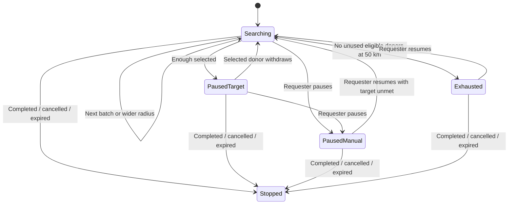

# Phase 1: donor coordination backend preview

This is a rule-based coordination agent. It does not establish medical suitability,
verify a hospital request, or prove any clinical benefit. SMS OTP is outside scope.
Dashboard and History now include the coordination screens. Comparative simulation
and the remaining release checks are still pending.

## Local activation and tests

The coordinator remains off by default while release work continues. To try the
new screens locally, set `COORDINATION_ENABLED=true` in the backend environment
and start the backend and frontend normally. Use a
separate development database. Atlas or another MongoDB replica set is required;
startup checks the topology and initializes the unique indexes. Production still
fails on database connection failure. The development fallback is temporary.

Run from the repository root:

```powershell
node --test backend/tests/foundation.test.js backend/tests/coordination.test.js
```

Tests start their own temporary MongoDB replica set, independent of `MONGO_URI`.
The first run may need to download MongoDB. Local loopback networking must be
allowed. Tests include simultaneous worker evaluations, competing selections,
daily alert caps, withdrawal, expiry, privacy, route access and worker recreation.

## API used by the coordination screens

Every endpoint requires a login bearer token for an existing, non-banned user.
Password-reset tokens are rejected.

| Method and path | Purpose |
| --- | --- |
| `POST /api/coordination` | Create a request and queue the first evaluation |
| `GET /api/coordination` | Up to 100 recent owned or invited requests |
| `GET /api/coordination/:id` | Participant-specific details; owner gets the timeline |
| `GET /api/coordination/location` | Read your own location and whether it is fresh/accurate enough for matching |
| `PATCH /api/coordination/location` | Save this donor's device fix or manually confirmed location |
| `POST /api/coordination/:id/actions` | Apply an owner or invited donor action |

Creation body example (test coordinates; the UI must ask the requester to confirm
the actual hospital pin):

```json
{
  "bloodGroup": "O+", "hospital": "Test Hospital", "district": "Test district",
  "hospitalLocation": { "lat": 0, "lng": 0 },
  "urgency": "normal", "candidateTarget": 2, "units": 1
}
```

`candidateTarget` counts people, independently of blood units. Both are integers
from 1 to 10. The request expiry is 48/24/6 hours for normal/urgent/critical.
Creation has a per-account cooldown and a per-account HTTP rate limit.

Actions:

```json
{ "action": "willing" }
{ "action": "declined" }
{ "action": "withdraw" }
{ "action": "select", "donorId": "DONOR_ID" }
{ "action": "pause" }
{ "action": "resume" }
{ "action": "cancel" }
{ "action": "complete", "donors": ["SELECTED_DONOR_WHO_ACTUALLY_DONATED"] }
```

Only the requester can select, pause, resume, cancel or complete. Completion
requires an explicit, nonempty subset of selected donors. Other selected donors
are not credited with donations, and all commitments are released. Completion
is requester-reported, not hospital verification. Repeating completion cannot
create more donation records. A request resolved without a recorded donor should
be cancelled in this preview.

Device location body: `lat`, `lng`, `source: "device"`, `accuracyMeters`,
`measuredAt` (ISO date or browser geolocation timestamp). Manual location body:
`lat`, `lng`, `source: "manual"`. Manual locations are labelled self-reported.
Old clients sending coordinates alone retain an unknown location source and are
excluded from automatic matching. Unknown, stale, invalid and imprecise device
locations are excluded; the default freshness limit is 24 hours and device
accuracy threshold is 1,000 metres. These are configurable prototype choices.
Client-reported location can be spoofed; this is not location verification.

## Algorithm

```text
Create request:
  validate confirmed hospital coordinates and input
  transactionally enforce account cooldown
  persist policy snapshot, stage, radius, deadline, next evaluation and log

Every 5 seconds, load up to 100 due or expired requests:
  begin transaction and write the request revision to serialize mutations
  if terminal: do nothing
  if deadline passed: expire, stop and release commitments
  if paused, exhausted or not yet due: do nothing
  mark unanswered invitations past their response window as no_response
  if enough selected: pause alerts
  else if enough willing and available, uncommitted candidates:
    wait for the requester's selection; retain the request deadline
  else:
    exclude previous recipients, busy, unavailable, banned, opted-out,
      incompatible, stale-location and daily-limit donors
    sort remaining candidates by straight-line hospital distance, then ID
    if this radius has candidates:
      invite a bounded batch, store notifications and counters atomically
      persist the next response-window evaluation and decision log
    otherwise expand immediately and repeat
    at 50 km with no unused candidates: mark automated search exhausted

On selection:
  transactionally claim a unique commitment for that donor
  pause alerts when the donor target is reached

On selected donor withdrawal:
  release the commitment
  restart from the urgency's initial radius unless manually paused
  previously alerted donors remain excluded
```

Default radii are 5, 10, 20 and 50 km. Normal starts at 5 km with 10-donor
batches and 300-second windows; urgent starts at 10 km with 20 and 120 seconds;
critical starts at 20 km with 50 and 45 seconds. Defaults are hypotheses for
evaluation, not claims of an optimal emergency policy. Each setting can be
changed through `COORDINATION_<URGENCY>_START_STAGE`, `_BATCH_SIZE` and
`_WAIT_SECONDS`. Radii must increase and end at 50 km. Active requests retain
their policy snapshot across restarts and environment changes.

## State diagrams

```mermaid
stateDiagram-v2
  [*] --> notified
  notified --> willing: I can help
  notified --> declined: Unavailable
  notified --> no_response: Response window elapsed
  no_response --> willing: Late offer while request active
  no_response --> declined: Late decline while request active
  willing --> selected: Requester selects; exclusive commitment acquired
  willing --> withdrawn: Donor withdraws
  selected --> withdrawn: Donor withdraws; commitment released
  selected --> completed: Requester explicitly records this donor's donation
```





Terminal requests prohibit further donor actions and release all commitments.
Their non-completed donor states remain as history, without an active commitment.
The request state must therefore always be displayed alongside the donor state.

## Delivery, privacy and durability

- A unique `(request, donor)` invitation and in-app notification are written in
  one transaction. A shared user counter enforces the UTC-day notification cap
  even when multiple requests evaluate concurrently.
- Socket events go to authenticated participant rooms. They are best-effort
  refresh signals, not proof that a donor saw an alert. Persistent invitations
  and notifications are the source of truth; the UI must reload on reconnect.
- Delivery is marked attempted before the socket emit. A crash in between can
  lose the immediate signal, but cannot lose the saved inbox item. This is not
  an exactly-once network-delivery claim. This increment adds no browser push
  delivery to the new coordinator.
- The detail API reveals donor/requester phone numbers only during active
  selection. Donor coordinates are never returned. Distances are rounded to
  whole kilometres and are straight-line estimates, not travel times.
- The general donor directory now omits exact coordinates. Its map can use
  existing district-centre fallbacks. Hospital coordinates are visible only to
  participants in the new workflow.
- Legacy jobs and public feeds exclude coordinated requests. Legacy response,
  status and rating endpoints cannot mutate them. Admin cancellation releases
  commitments; hard deletion of coordinated requests is blocked to retain
  donation records and the timeline.

## Remaining work before deployment

- Completed-only leaderboard/badges and migration rules for legacy responses.
- Complete the legacy REST privacy and contact-display audit; this increment
  does not claim all old contact endpoints have been fixed.
- Account deletion/ban cleanup for active commitments and owned requests.
- Shared request throttling across the old posting routes and the new route.
- Geographic indexing, candidate pagination and timeline pagination for scale.
  The preview scans matching fresh donors and stores the full decision timeline.
- Deterministic multi-policy simulation, CSV results and tuning of critical
  broadcast behaviour based on those results. No comparative results exist yet.
- Production deployment verification and broader device/accessibility testing.
  The local frontend build and isolated browser workflow are checked separately.
  The worker requires a running backend; suspended hosting cannot provide
  continuous processing.
- The new coordination panel currently uses English text; Tamil localization
  of these new controls remains pending.

User recruitment, genuine request verification, cross-matching and final donor
eligibility remain operational responsibilities, not guarantees of this algorithm.
